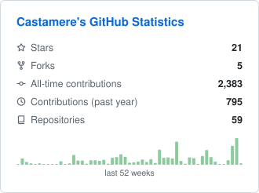
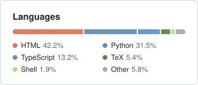

#  better-github-profile

GitHub profile stats cards, built by a GitHub Action in your own repo: correct numbers, light and dark versions, and nothing to host.

[](#privacy)

## Themes

**native**: an overview card and a languages card.

<picture>
  <source media="(prefers-color-scheme: dark)" srcset="test/__snapshots__/native-overview-dark.svg">
  
</picture>
<picture>
  <source media="(prefers-color-scheme: dark)" srcset="test/__snapshots__/native-languages-dark.svg">
  
</picture>

**strip**: everything on one wide line.

<picture>
  <source media="(prefers-color-scheme: dark)" srcset="test/__snapshots__/strip-strip-dark.svg">
  
</picture>

## Quick start

The [selector page](https://casta-mere.github.io/better-github-profile/) previews the themes and writes the setup for your choices. With the defaults, the setup is these three steps, all in your profile repository (the one named after your username).

**1. Token.** Create a classic personal access token with the read:user scope (add the repo scope to include private work) and save it in your profile repository as the Actions secret STATS_TOKEN.

**2. Workflow.** Save this as `.github/workflows/profile-cards.yml`:

```yaml
name: Profile cards

on:
  schedule:
    - cron: '17 3 * * *' # daily, 03:17 UTC
  workflow_dispatch:

# A manual run and a scheduled run never push at the same time.
concurrency:
  group: profile-cards
  cancel-in-progress: false

jobs:
  update:
    runs-on: ubuntu-latest
    permissions:
      contents: write
    steps:
      - uses: actions/checkout@v7
      - uses: casta-mere/better-github-profile@v1
        with:
          token: ${{ secrets.STATS_TOKEN }}
```

Run it once from the Actions tab, or wait for the daily run. It commits the cards and `cards/snapshot.json`, and later runs commit only when something changed.

**3. README.** Paste this into `README.md`:

```html
<picture>
  <source media="(prefers-color-scheme: dark)" srcset="cards/native-overview-dark.svg">
  
</picture>
<picture>
  <source media="(prefers-color-scheme: dark)" srcset="cards/native-languages-dark.svg">
  
</picture>
```

## Inputs

| Input | Default | Description |
| --- | --- | --- |
| `token` | *required* | Classic personal access token with `read:user`, plus `repo` to include private work. Pass `${{ secrets.STATS_TOKEN }}`. |
| `theme` | `native` | `native` or `strip`. |
| `cards` | — | Comma-separated cards to render: `overview` and `languages` for `native`, `strip` for `strip`. Empty renders all of the theme's cards. |
| `stats` | — | Comma-separated stats, in display order, e.g. `stars,followers,allTime`. Keys: `stars`, `forks`, `allTime`, `pastYear`, `repos`, `followers`, `commits`, `pullRequests`, `issues`, `reviews`, `private`, `joined`. Empty uses the theme's default: `stars,forks,allTime,pastYear,repos` for `native`, `allTime,pastYear,repos,stars,followers` for `strip`. `strip` shows at most 6. |
| `exclude_repos` | — | Comma-separated repository names to leave out, case-insensitive. |
| `exclude_langs` | — | Comma-separated languages to leave out, case-insensitive. |
| `include_forks` | `false` | Count forked repositories. |
| `include_private` | `true` | Count private work, as totals only. See [Privacy](#privacy). |
| `output_dir` | `cards` | Directory for the cards and `snapshot.json`. |
| `telemetry` | `true` | Send the usage ping. See [Privacy](#privacy). |

Each card is written twice, as `<theme>-<card>-light.svg` and `<theme>-<card>-dark.svg`.

## How it stays correct

A fetch that fails, or that suddenly reports 0 stars, repositories, contributions or language bytes where the last run had more, never replaces the data in `cards/snapshot.json`. The cards are re-rendered from that last good snapshot with a small `stale · data as of <date>` note, and the step ends with a warning that names the cause instead of failing. If a value really did drop to zero, delete `cards/snapshot.json` and the next run starts fresh.

## Privacy

- Private work is counted as totals only: contributions, stars and language bytes. Private repository names are never stored.
- `include_private: false` fully hides private contributions only with a token that has just `read:user`. With a `repo`-scoped token, GitHub reports contributions to your own private repos as ordinary contributions, so they stay in the totals. The weekly sparkline is GitHub's contribution calendar as is, which can't be split into private and public either.
- Besides `api.github.com`, the only call is the usage ping, sent once per run with exactly `{ id, version, theme }`.
- The `id` is a SHA-256 hash of your repository's ID. That makes it pseudonymous, not anonymous: repo IDs are short integers, so whoever holds the stored ids, in practice the project owner, could work out which repo sent them.
- To opt out, set `telemetry: false`. Nothing is sent then.
