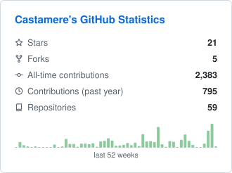
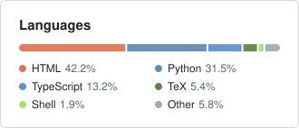

# native

Two cards that look like part of GitHub: Primer colors, the system font, a thin border and GitHub's corner radius. The quiet default.

- **Author:** [Casta-mere](https://github.com/Casta-mere)
- **Cards:**
  - `overview`: stars, forks, all-time and past-year contributions, repositories, and a 52-week sparkline.
  - `languages`: a segmented bar of the top 5 languages plus Other, with a two-column legend.
- **Size:** 330px wide each; the height follows the content.
- **Design:** option A of the original mockups, kept in [`mockup.html`](mockup.html).

## Preview

Rendered from the public test fixture (`test/fixtures/snapshot-casta-mere.json`).

<picture>
  <source media="(prefers-color-scheme: dark)" srcset="../../../../test/__snapshots__/native/native-overview-dark.svg">
  
</picture>
<picture>
  <source media="(prefers-color-scheme: dark)" srcset="../../../../test/__snapshots__/native/native-languages-dark.svg">
  
</picture>

## Use it

```yaml
- uses: casta-mere/better-github-profile@v1
  with:
    token: ${{ secrets.STATS_TOKEN }}
    theme: native # the default
    cards: overview,languages # the default: both
```
